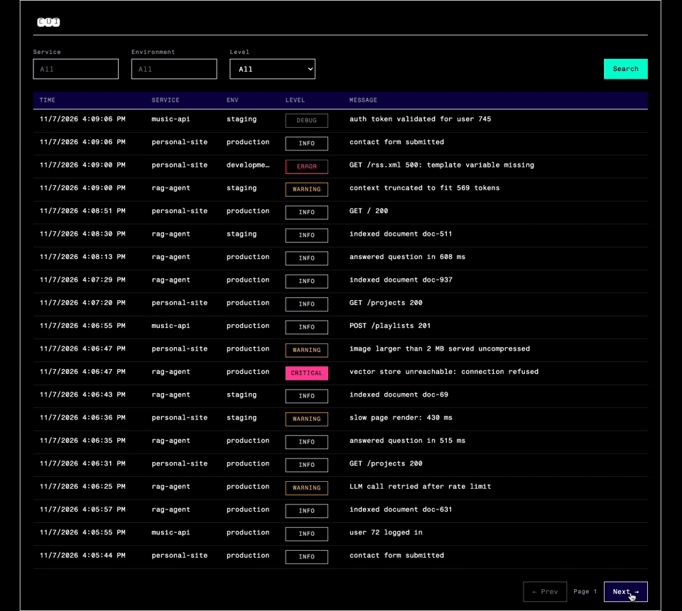

# Cui

[](https://github.com/Han-Long-gs/cui-log-platform/actions/workflows/ci.yml)

Cui is a self-hosted log platform. Your apps send logs to it over HTTP, and you browse them in a web UI, filtered by service, environment and level.

The main idea is that ingestion should stay fast and available even when the database is slow or down. The API only validates a batch, puts it on a queue (RabbitMQ) and returns `202`. Celery workers then write it to PostgreSQL at the speed the database can take.



## How this was built

I built Cui as a learning project with Claude Code acting as my tech lead. I did a small write-up about my approach in building this project here: [how-i-learn-with-ai](https://gensosanso.com/projects/how-i-learn-with-ai), please feel free to check it out :>

**Written by me**

- All application code: the ingestion API (sync and queue modes), the
  Celery worker (task, retries, batch state machine), the query API
  (filters, keyset pagination, stats), the database models and every
  Alembic migration
- API Design: [design/api-design.md](design/api-design.md)
- UI Design (Figma url included): [design/ui-design.md](design/ui-design.md)
- The frontend (React + TypeScript)
- Dockerfiles for the ingestion API and worker, most of the docker-compose.yml, the nginx config, and the CI workflow (GitHub Actions)
- Running every test (and the mutations), benchmark and fault test, and the analysis in
  [results/keyset-vs-offset](results/keyset-vs-offset/README.md)

**Written by Claude**

- Almost all of the test suite, including fixtures
- Benchmark, fault-injection and demo-data scripts in `scripts/`
- Smaller infra pieces: `.dockerignore`, the `migrate` service and its
  Dockerfile, the rest of `docker-compose.yml`
- Drafts of [design/architecture.md](design/architecture.md),
  [results/fault-worker-crash](results/fault-worker-crash/README.md),
  [frontend/README.md](frontend/README.md), and the scope section of the
  benchmark write-up

## Architecture

See [design/architecture.md](design/architecture.md) for the system overview and the sequence diagrams for the sync baseline and the queue pipeline.

## Evidence

| Test | Result | Details |
|---|---|---|
| Keyset vs OFFSET pagination, 1M rows | At page 1000, keyset takes 3.4 ms and OFFSET takes 119 ms (p50). Keyset stays flat as the page gets deeper | [results/keyset-vs-offset](results/keyset-vs-offset/README.md) |
| `kill -9` the worker under steady traffic | 3 runs, 205,800 events: none missing and none duplicated, including 3 kills while a batch was being processed | [results/fault-worker-crash](results/fault-worker-crash/README.md) |

Both were run on my local machine, and each write-up has a section on what it does not cover.

## Quickstart

### Prerequisites

- Docker Desktop + uv
- Windows only: WSL2 Ubuntu -> enable WSL Integration for Ubuntu in Docker Desktop -> install uv in Ubuntu
  - run every command below in the Ubuntu shell
- idle localhost:80

### Run

```bash
git clone https://github.com/Han-Long-gs/cui-log-platform.git
cd cui-log-platform
cp .env.example .env    # replace every <placeholder>, letters and digits only
docker compose up -d --build
```

The first run takes 1-2 minutes (pulls images and builds). Then check:

```bash
docker compose ps
```

`migrate` should be `Exited (0)`; every other service `running` or `healthy`.

### Load demo data

```bash
uv run python scripts/seed_demo.py
```

Sends 10,000 logs (3 services, 3 environments, 5 levels, last 24 hours) through the same entry point a client would use.
Open http://localhost and filter by service / environment / level.

### Stop

```bash
docker compose down       # keeps the data
docker compose down -v    # also deletes the database and queue data
```

PostgreSQL (`127.0.0.1:5433`) and the RabbitMQ management UI (`127.0.0.1:15672`) are also published on localhost, for local debugging only.
