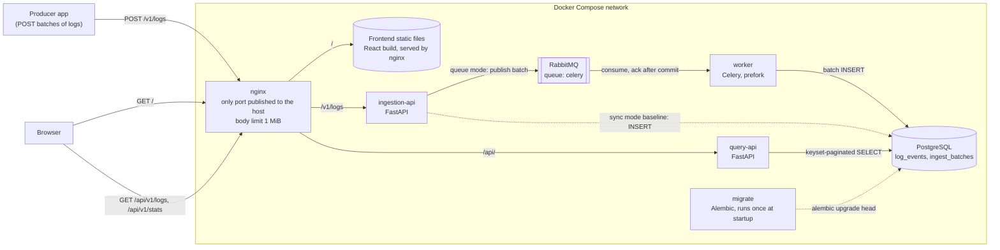
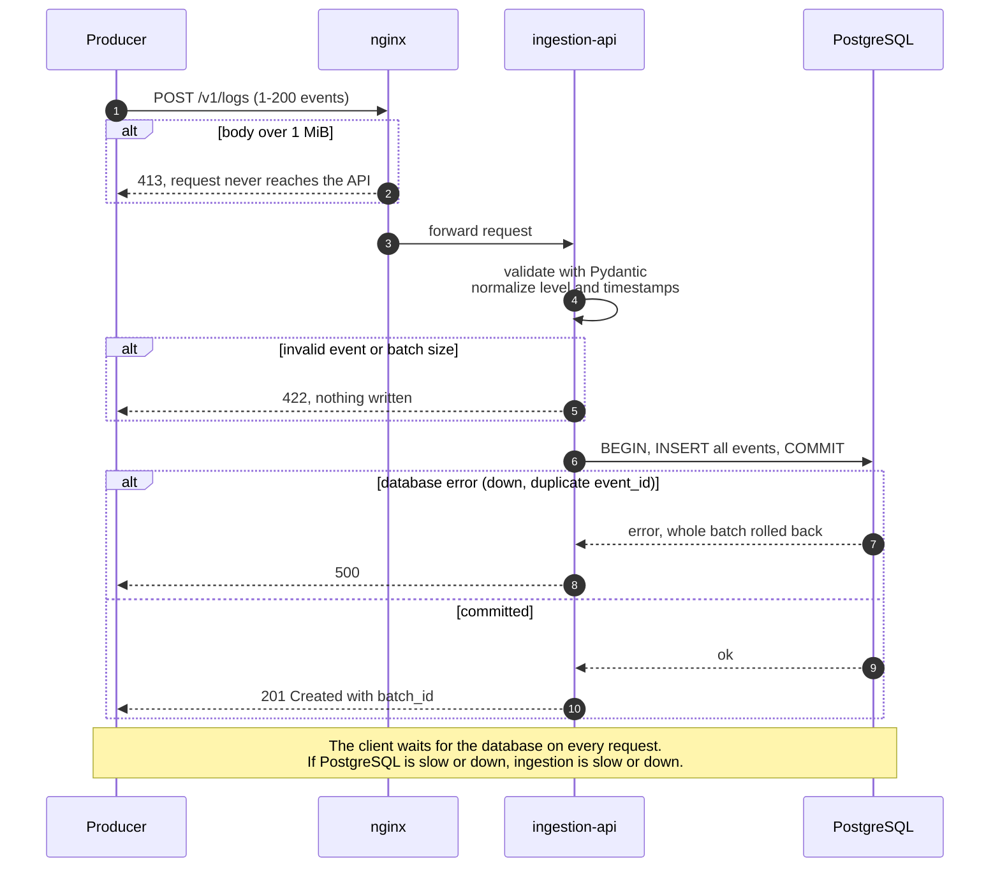
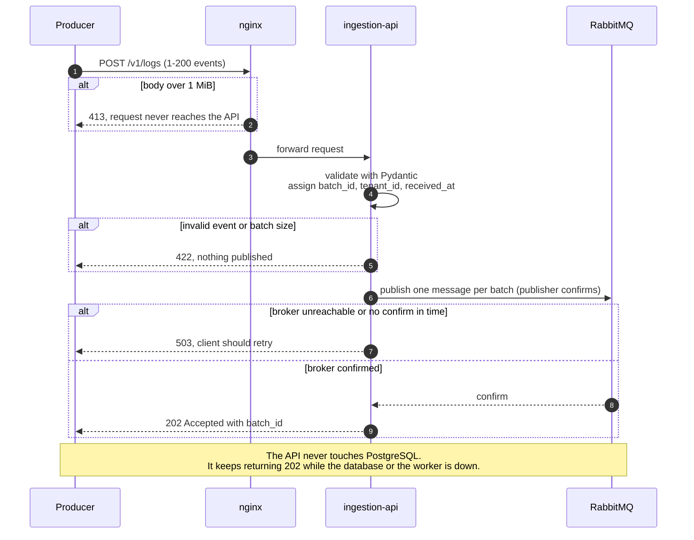
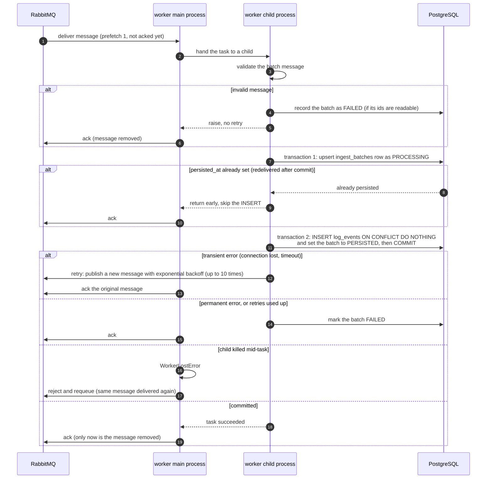

# Architecture

## System overview

The ingestion API has two modes, chosen by `INGEST_MODE`. Queue mode is the default. Sync mode is the baseline kept for benchmarking.

## Sync pipeline (baseline, `INGEST_MODE=sync`)

## Async pipeline (`INGEST_MODE=queue`, default)

### Request path: accept and publish

### Worker path: consume and persist

Acks are sent only after the task finishes (`task_acks_late`), so a crash before that point leaves the message in RabbitMQ to be delivered again. Two guards keep a redelivery from storing a batch twice: the `persisted_at` check above, and `UNIQUE (tenant_id, event_id)` with `ON CONFLICT DO NOTHING`.
