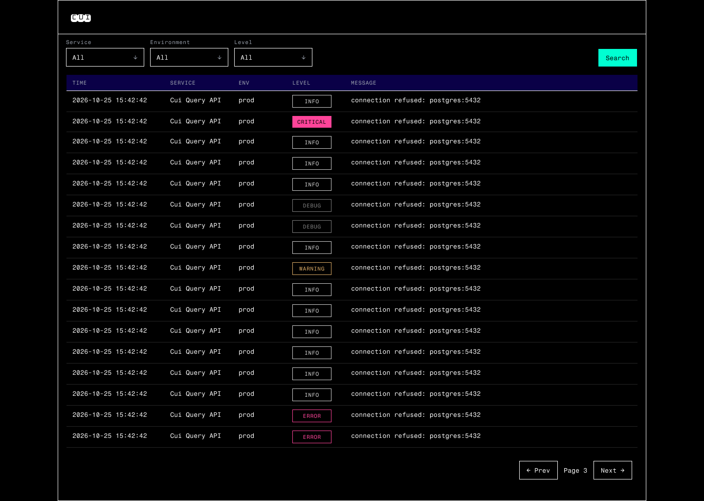
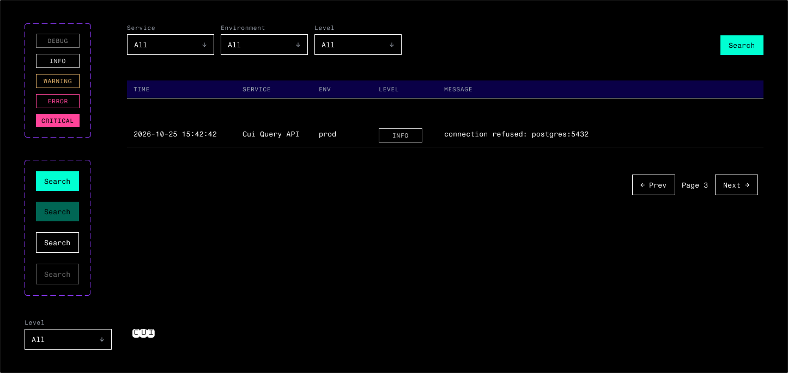

# V1 UI

Figma design here: https://www.figma.com/design/Sbs7VUn5VjOx06eU7gfIje/Cui?node-id=2-2&t=SmduN50xflIJg59Y-1

## Logs page

## Components

## Tokens

| Figma                                                                  | CSS                                             |
| ---------------------------------------------------------------------- | ----------------------------------------------- |
| `bg` `#000000`                                                         | `--bg`                                          |
| `surface` `#0A0047`                                                    | `--surface`                                     |
| `text` `#FFFFFF` / `text-muted` `#9CA3AF`                              | `--text` / `--text-muted`                       |
| `border` `#FFFFFF` / `divider` `#262626`                               | `--border` / `--divider`                        |
| `bg-button` `#00FFD2` / `text-button` `#000000`                        | `--bg-button` / `--text-button`                 |
| `text-level-debug` `#808080`                                           | `--text-level-debug`                            |
| `text-level-info` `#D4D4D4`                                            | `--text-level-info`                             |
| `text-level-warning` `#E0AF68`                                         | `--text-level-warning`                          |
| `text-level-error` `#FF4499`                                           | `--text-level-error`                            |
| `bg-level-critical` `#FF4499` / `text-level-critical` `#000000`        | `--bg-level-critical` / `--text-level-critical` |
| `space-1` 4 / `space-2` 8 / `space-3` 12 / `space-4` 16 / `space-6` 24 | `--space-1` … `--space-6`                       |
| Text style `title` 24/32, Monofett                                     | `--font-title`, `--font-size-title`             |
| Text styles `body` 13/20, `label` 11/16 uppercase +6%, Fragment Mono   | `--font-body`, `--font-size-*`                  |
