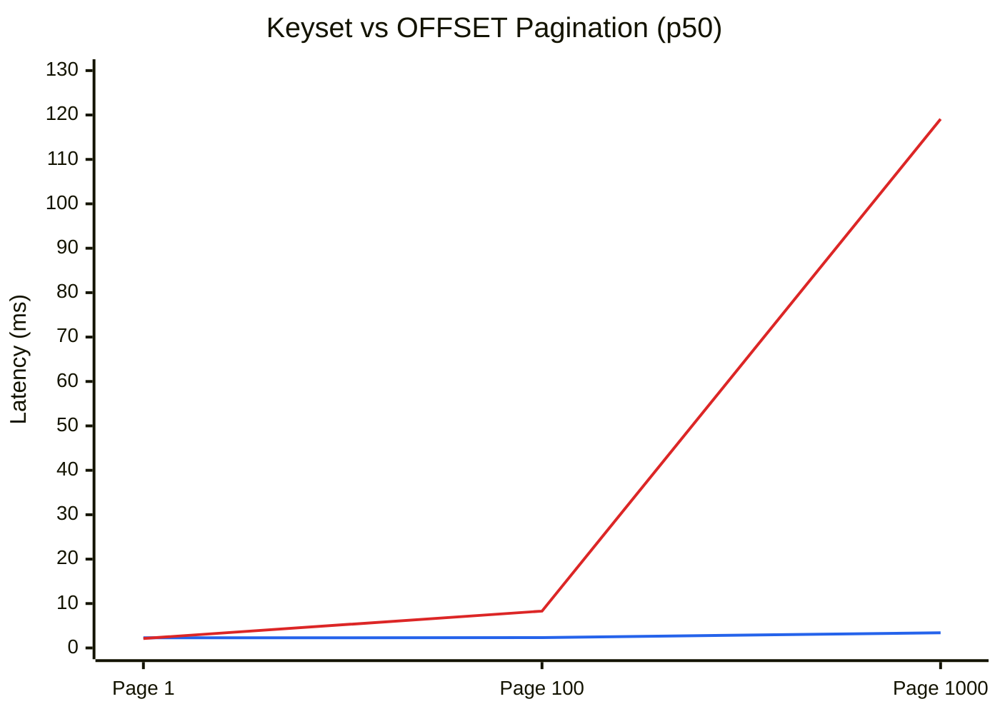
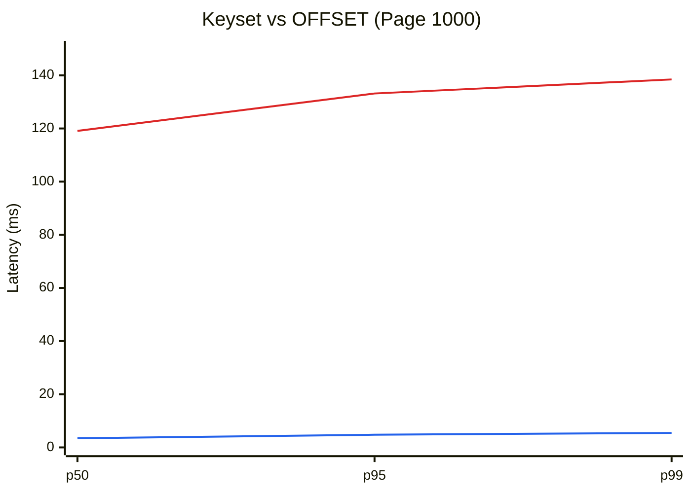

# Performance Analysis: keyset vs offset

## At the first glance: comparing the results between two approaches (p50)

**_Blue: keyset Red: offset_**

The p50 (median) latency was selected as the primary visualization metric in this section because a. the experiment focuses on comparing the typical query performance of keyset and offset pagination as page depth increases, and b. the similar latency trend can be observed in p95/p99 as well. As observed in the chart, the performance difference between two approaches is not very significant when the page depth is shallow, but the offset approach's latency grows in a linear trend when the page depth gets deeper, as it skipped 0/9900/99900 rows for case page 1/100/1000.

## A closer look: when the pagination approach really matters

Next, we compare the case page 1000 between two approaches, where the execution time for offset approach is significantly slower than the keyset approach across p50/95/99.

**_Blue: keyset Red: offset_**

The [keyset-page-1000.txt](explain/keyset-page-1000.txt) and [offset-page-1000.txt](explain/offset-page-1000.txt) documented the executed queries and the Postgres' plan for the read request of the 1000th page with 100 records per page. As we can see in the Index Scan section, both approaches have the same index ix_tid_occurred planned out. However, in the Index Cond, offset has no condition that tells the index which occurred_at to start to scan, so it has to start from the latest occurred_at for the given tenant_id. The Index Scan line shows this: actual rows=102 for keyset vs actual rows=100002 for offset. The performance difference is highlighted in the Buffers, as the keyset only shows shared hit=107, which indicates the data was already cached and was accessed in the pg's shared_buffers, while the offset approach has shared hit=85857 (cache hit) and read=14558 (not in pg's cache; have to be fetched from the OS cache or disk), about 100415 pages in total against keyset's 107 pages, for the same 100 rows.

## Conclusion

The query time for the offset approach grows linearly as the page depth grows deeper, because its cost is proportional to the number of rows it reads and then throws away before the requested page, while the query time for the keyset approach stays roughly constant across different page depth, because the cursor lets the index start right at the requested page's first row, so it reads only about one page of rows no matter how deep it is.

## Scope and limitations

- Local machine, one client. This test result is performed on the local machine and under one client sending
  sequential requests. It cannot reflect the latency under high concurrency (i.e. multiple clients query the same table).
- Service layer only. Timings wrap a direct call to
  `fetch_log_events`, not `GET /api/v1/logs`, so they leave out HTTP,
  nginx and cursor encoding/decoding.
- Warm cache. Each case runs 5 warm-up calls and reuses the same
  cursor or offset, so the pages it reads are already in memory. Paging
  through old, rarely read data would be slower.
- Dataset. 1,000,000 rows in one tenant, shared_buffers 128 MB;
  production data would differ in size, number of tenants and hardware.

## Authorship

The benchmark script ([`scripts/bench_keyset_vs_offset.py`](../../scripts/bench_keyset_vs_offset.py)) and the Scope and limitations section were written with Claude (AI assistant). Han ran the benchmark and wrote the analysis.
